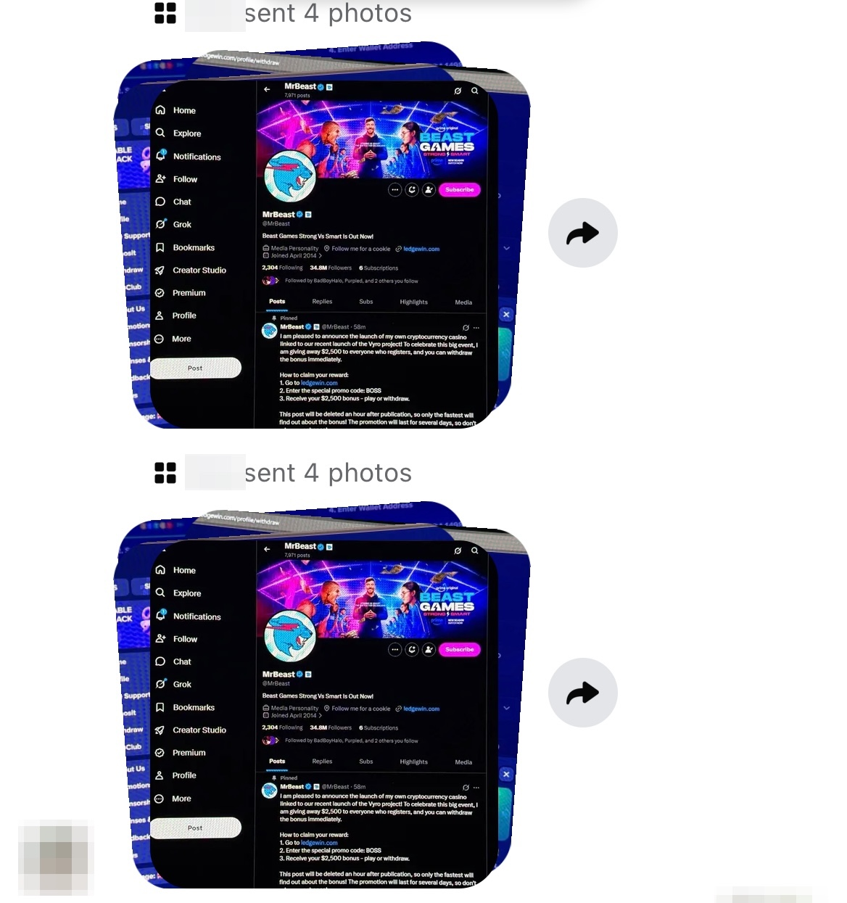
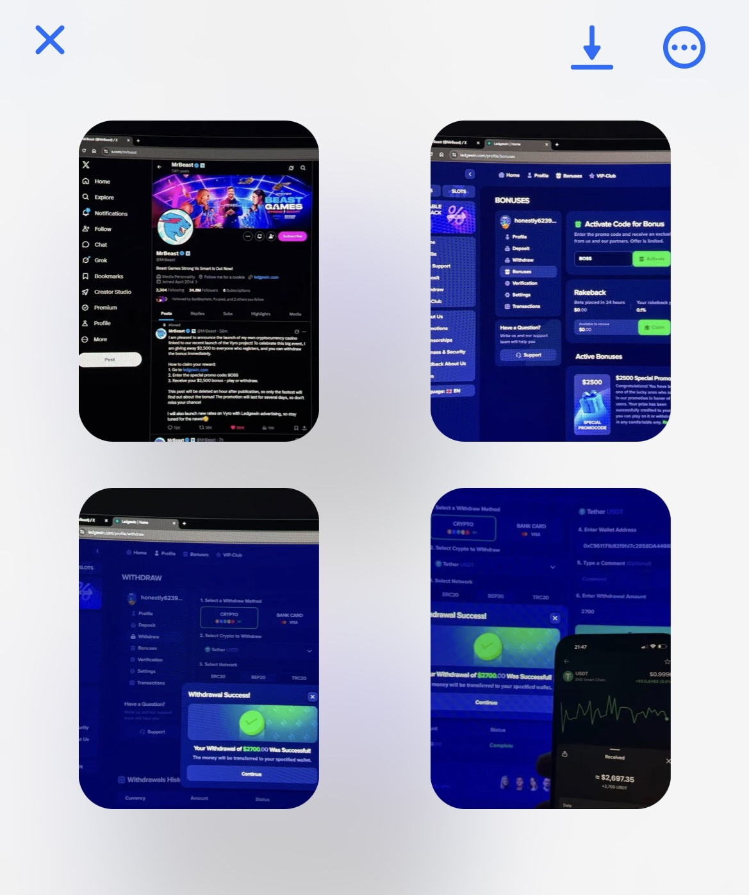

# Cảnh báo: quảng cáo Google "app dọn dẹp Mac" phát tán mã độc đánh cắp tài khoản

> 14/10/2026 · macOS · Mức độ: **Nguy hiểm**
> Các link trong tài liệu đã bị vô hiệu hoá (`hxxps`, `[.]`). **Không truy cập.**
> Phân tích kỹ thuật chi tiết: [ANALYSIS.md](ANALYSIS.md)

## Khi bị hack: tài khoản của nạn nhân tự gửi ảnh lừa đảo

| Tin nhắn Messenger gửi đi hàng loạt | 4 ảnh lừa đảo |
|---|---|
|  |  |

Nội dung ảnh: một bài đăng X (Twitter) **giả mạo MrBeast**, quảng cáo "casino crypto" `ledgewin[.]com`, kêu gọi nhập mã **`BOSS`** để nhận **$2,500**, kèm ảnh "rút tiền thành công" ra USDT để tạo lòng tin. **Đây là lừa đảo.** Trang này dụ người dùng nạp tiền hoặc "phí rút" và không bao giờ trả lại.

## Tóm tắt

Nạn nhân tìm "cleaner app mac" trên Google, bấm vào **quảng cáo** ở đầu trang, rồi tải và cài một "app dọn dẹp". Thực chất đó là **mã độc đánh cắp mật khẩu và phiên đăng nhập** trên Mac (ESET gọi là `OSX/PSW.Agent.KQ`).

**Chưa đầy một ngày sau**, tài khoản Facebook của nạn nhân bị chiếm và dùng để phát tán **ảnh quảng cáo lừa đảo crypto mạo danh MrBeast**.

## Chuyện gì đã xảy ra

| Thời điểm | Sự kiện |
|---|---|
| 14/10/2026, khoảng 18:30 | Bấm quảng cáo Google, tải `Installer.dmg`, kéo app ra và mở. **Không có app nào hiện lên**: không cửa sổ, không icon trên Dock |
| Ngay sau đó | Loại mã độc này thường hiện **popup giả đòi mật khẩu Mac** |
| 15/10/2026, khoảng 16:00 | Facebook bị chiếm, tự gửi và đăng ảnh lừa đảo crypto "MrBeast" |

Kẻ gian **không cần mật khẩu Facebook, và 2FA cũng không chặn được**. Mã độc lấy **cookie đăng nhập** trong trình duyệt (nếu có mật khẩu Mac từ popup giả, nó còn mở được **Keychain**, nơi Mac cất mật khẩu và khoá giải mã dữ liệu trình duyệt), và kẻ gian vào thẳng tài khoản như thể chính nạn nhân đang dùng.

## Cái bẫy

```
Google: "cleaner app mac" → bấm QUẢNG CÁO
        ▼
cleanerappmac[.]com/appscleaner/?ref=4770fc3bbab0    (trang giả, có nút Download)
        ▼
Tải Installer.dmg → mở Installer.app
        ▼
App âm thầm tải thêm 3 lớp mã độc từ Internet → đánh cắp dữ liệu
```

**Mở app mà không thấy gì xảy ra là dấu hiệu nguy hiểm, không phải "app lỗi".** App được thiết kế để **ẩn hoàn toàn**: không cửa sổ, không icon trên Dock. Trong lúc người dùng tưởng app hỏng và bỏ qua, nó âm thầm tải và chạy mã độc. Loại mã độc này thường hiện thêm **popup giả đòi mật khẩu Mac**. Không có bước cài đặt nào ở đây thật sự cần mật khẩu. Mở một "trình cài đặt" mà không thấy gì, hoặc bỗng bị hỏi mật khẩu, thì hãy coi như máy đã bị nhiễm và làm ngay các bước ở mục [Nếu đã lỡ mở file](#nếu-đã-lỡ-mở-file).

**Vì sao khó nhận ra:**

- **Quảng cáo nằm trên đầu kết quả Google**, trông như kết quả thật.
- **Tên miền mới tinh**: `cleanerappmac[.]com` được đăng ký **3 ngày** trước đó. Máy chủ chứa mã độc còn được đăng ký **1 ngày** trước.
- **Trang giả biết tự ẩn mình**: vào thẳng `cleanerappmac[.]com` thì chỉ thấy lỗi **404**, nhưng link trong quảng cáo (có `?ref=…`) vẫn hiện nút tải. Ai kiểm tra tên miền sẽ tưởng trang đã chết. Mã `ref` dùng để trả tiền cho kẻ đã kéo nạn nhân tới.
- **File có chữ ký và được Apple "duyệt" (notarize)**, nên macOS không cảnh báo mạnh.
- **Phần mềm diệt virus không phát hiện được**: file tải về được **[VirusTotal 0/61](https://www.virustotal.com/gui/file/320c777f39a64138a76966ce01557ede0fd5e8fec82c6495c4d020fe1dd94204)**. Phần độc hại thật chỉ được tải về **sau khi mở app**, và lớp cuối lúc đầu chỉ bị 2 phần mềm diệt virus phát hiện (một ngày sau tăng lên **15/57**, gồm Kaspersky, Sophos, Avast, Microsoft, Symantec). "Quét sạch" **không** có nghĩa là an toàn.

## Đây không phải trường hợp đơn lẻ

Bitdefender ([bài viết 02/2026](https://www.bitdefender.com/en-au/blog/hotforsecurity/hijacked-google-ads-push-fake-7-zip-notepad-and-office-downloads-to-mac-users-via-evernote-pages)) ghi nhận một chiến dịch rất giống:

- Kẻ gian **chiếm tài khoản quảng cáo Google của các doanh nghiệp thật** (hơn 35 tài khoản, hơn 200 quảng cáo) để quảng cáo phần mềm giả cho Mac, **trong đó có các app dọn dẹp** như AppCleaner, PearCleaner, cùng với 7-Zip, Notepad++, Office…
- Có biến thể yêu cầu nạn nhân **dán một lệnh vào Terminal** để "cài đặt".
- Mã độc (MacSync) lấy mật khẩu, cookie trình duyệt, ví crypto, Telegram, Notes, và hiện **hộp thoại giả đòi mật khẩu Mac**.
- Cùng một nhóm chạy song song trên **Google Ads và quảng cáo Meta (Facebook)**.

Tài khoản bị đánh cắp (Facebook, tài khoản quảng cáo) sau đó lại bị dùng để **chạy quảng cáo hoặc lừa đảo tiếp**. Đó chính là điều đã xảy ra với nạn nhân trong vụ này.

## Cách phòng tránh

- **Không tải phần mềm từ quảng cáo.** Lướt qua các kết quả "Được tài trợ" và gõ thẳng trang chủ của hãng, hoặc dùng **Mac App Store**.
- **Tên miền lạ, mới, hoặc trang chủ lỗi mà link có `?ref=` vẫn cho tải** thì đó là lừa đảo.
- **Không bao giờ dán lệnh vào Terminal** theo hướng dẫn của trang web hay video.
- macOS cảnh báo "không xác minh được" hoặc "có thể là phần mềm độc hại" thì **dừng lại**. Đừng tìm cách mở bằng được.
- **Hộp thoại đòi mật khẩu Mac hiện ra sau khi mở app lạ, bấm Cancel vẫn hiện lại**, thì đó là giả. Đừng gõ mật khẩu.
- Dùng **trình quản lý mật khẩu** riêng thay vì lưu mật khẩu trong trình duyệt. Không lưu seed phrase của ví trong Notes hay file text.

## Nếu đã lỡ mở file

Coi như **mọi tài khoản từng đăng nhập trên máy đó đã bị lộ**, không riêng gì Facebook. Kẻ gian thường dùng Facebook trước, rồi chuyển sang các tài khoản khác.

**1. Ngắt mạng máy Mac đó ngay.** Mọi bước sau làm trên **một thiết bị khác, sạch** (điện thoại hoặc máy khác).

**2. Kiểm tra lần lượt TẤT CẢ tài khoản** từng đăng nhập trên máy đó: **đăng xuất mọi thiết bị**, **đổi mật khẩu**, kiểm tra 2FA và email khôi phục. Làm **email trước tiên**, rồi đến Apple ID, mạng xã hội và chat, ngân hàng, ví điện tử, crypto (chuyển sang ví mới), tài khoản công việc và các trang mua sắm. Mở danh sách mật khẩu đã lưu trong trình duyệt để không bỏ sót tài khoản nào. Báo bạn bè đừng bấm vào tin nhắn lạ gửi từ tài khoản của bạn.

**3. Xử lý máy Mac:** sao lưu tài liệu cần thiết (không sao lưu app), rồi **cài lại macOS**. Sau đó đổi mật khẩu đăng nhập Mac.

**4.** Nếu là máy công ty, **báo IT hoặc bộ phận bảo mật ngay**.

Facebook mất quyền truy cập thì vào [facebook.com/hacked](https://www.facebook.com/hacked).

## Dấu hiệu nhận biết (IOC)

| Loại | Giá trị |
|---|---|
| Trang giả | `cleanerappmac[.]com/appscleaner/?ref=4770fc3bbab0` |
| Domain | `cleanerappmac[.]com`, `deepteks[.]com`, `chantcompass9[.]com`, `raster-87[.]com` |
| Trang lừa đảo phát tán qua tài khoản bị chiếm | `ledgewin[.]com` (mã khuyến mãi `BOSS`) |
| File trên máy bị nhiễm | `/tmp/.cid9mtl` |
| App | `Installer.app` (tên thật "Wan", `com.yard.wan`); mã độc cuối tự xưng `org.slack.notifier` (mạo danh Slack) |
| Chứng chỉ | Developer ID: URAZ SESTMER (`YXSRL98558`) |
| SHA-256 file tải về | `320c777f39a64138a76966ce01557ede0fd5e8fec82c6495c4d020fe1dd94204` · [VirusTotal](https://www.virustotal.com/gui/file/320c777f39a64138a76966ce01557ede0fd5e8fec82c6495c4d020fe1dd94204) |
| SHA-256 mã độc cuối | `8df733ce1f313241964d655f7afc1978d470f7b3e08f603f5212199001798a0e` · [VirusTotal](https://www.virustotal.com/gui/file/8df733ce1f313241964d655f7afc1978d470f7b3e08f603f5212199001798a0e) · [Behavior](https://www.virustotal.com/gui/file/8df733ce1f313241964d655f7afc1978d470f7b3e08f603f5212199001798a0e/behavior) |

Mẫu mã độc nằm trong `samples.7z` (mật khẩu `infected`). **Không giải nén trên Mac.**
